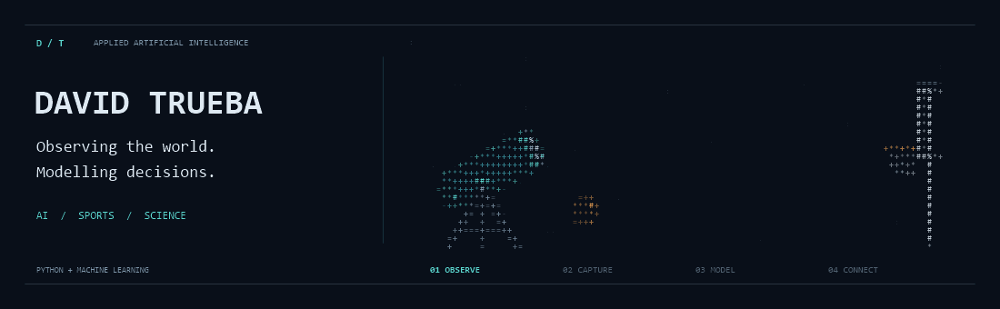

**Artificial Intelligence student at Universitat Autònoma de Barcelona.**

I build projects that connect machine learning with practical decisions:
matching translators to assignments, analysing NBA shots and exploring
music through neural networks.

My experience also includes Python development for telescope-control
software, science outreach and Python tutoring.

**Interests:** Applied AI · Sports analytics · Scientific software

[Email](mailto:dtruebaperiago@gmail.com)

---

## Selected projects

### 01 · Translator Assignment Automation
**Predicting translator suitability for individual assignments**

A team project combining a neural network with a dashboard to help a
product manager compare available translators and identify suitable
candidates for each assignment.

- Estimates suitability based on the assignment and translator.
- Supports comparison under different matching criteria.
- Connects model predictions with a practical decision-support interface.

**Focus:** Neural networks · Matching · Decision support · Dashboard development

[Explore the project →](https://github.com/dtruebaperiago/translator-assignment-automation)

### 02 · NBA Shot Quality
**Understanding shooting performance in context · In development**

A personal project estimating the probability of making a shot from its
game context, including distance to the basket, proximity of the nearest
defender, shot type, time remaining and score difference.

I'm developing a platform for coaches and analysts to explore:

- Expected shot success based on the shooting situation.
- Observed player performance compared with model expectations.
- Shot selection and differences in the opportunities players take.

**Focus:** Predictive modelling · Sports analytics · Data visualisation

[Follow the development →](https://github.com/dtruebaperiago/NBA-Shot-Quality)

### 03 · Montsec Sky Telescope
**Python development for scientific instrumentation**

Collaborative development of ASCOM Alpaca drivers for the Montsec Sky
Telescope, contributing to implementation and testing.

The work involved interpreting technical documentation and applying
software standards to telescope-control software.

**Focus:** Python · ASCOM Alpaca · Hardware integration · Testing

[Private repository — request access](mailto:dtruebaperiago@gmail.com)
---

## More projects

### Music Genre Classification
A university team project classifying music genres from visual
representations of audio, using a neural architecture with recurrent
components and attention mechanisms.

**Focus:** Deep learning · Audio classification · Recurrent neural networks · Attention

[Explore the project →](https://github.com/dtruebaperiago/Music-Genre-Classification)

### Employee Survey Dashboard
A hackathon team project building an HR dashboard that generates employee
questionnaires using bias indicators calculated from previous surveys
to guide the generation process.

**Focus:** Applied AI · Survey analysis · Automation · Dashboard development

[Explore the project →](https://github.com/dtruebaperiago/Damm_Hack)

---

## Technical toolkit

| Area | Technologies |
| :--- | :--- |
| Programming | Python, C, C++ |
| Data querying | SQL |
| Data analysis & manipulation | pandas, NumPy |
| Machine learning & deep learning | scikit-learn, PyTorch |
| Automation | n8n |
| Scientific software | ASCOM Alpaca |

---

## Beyond the code

- **Science outreach:** Delivered public explanations of the August 2026
  solar eclipse and ran daytime solar telescope observations during
  July 2026, handling equipment transport, setup, pointing and operation.
- **Python tutoring:** Explained programming concepts and supported
  learners with code review and debugging.
- **Languages:** Native Catalan and Spanish · English C1

---

I'm interested in opportunities to apply Python and machine learning,
collaborate with a team and keep developing my technical skills.

[Get in touch →](mailto:dtruebaperiago@gmail.com)
